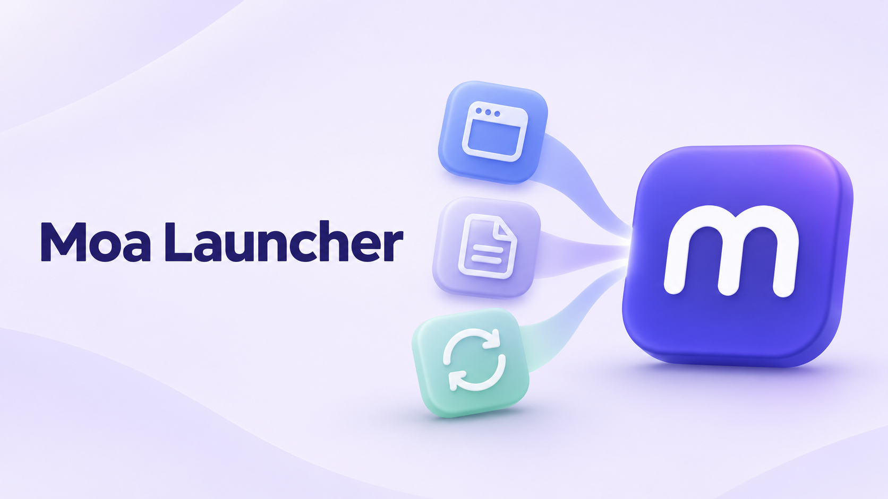

# Moa Launcher



**모아 프로그램을 한곳에 모아 설치하고, 최신 버전을 확인하는 Windows 런처입니다.** GitHub Releases에서 배포자의 설치 파일을 내려받아 확인한 뒤 프로그램을 설치하고 실행합니다. 새 앱은 카탈로그에 추가하거나 앱 화면에서 등록할 수 있습니다.

## 시작하기

[최신 릴리스](https://github.com/hebory/moalauncher/releases/latest)에서 `MoaLauncher-<버전>-Setup-x64.exe`를 내려받아 실행하세요. 현재 사용자 계정에 설치되며 시작 메뉴의 **Moa Launcher**로 열 수 있습니다. 별도 .NET 설치는 필요하지 않습니다. 포터블 사용은 같은 릴리스의 ZIP을 별도 폴더에 풀어 실행하면 됩니다.

소스에서 실행하려면 Windows와 .NET 8 SDK가 필요합니다.

```powershell
dotnet run --project src/MoaLauncher.App
```

기본 카탈로그에는 [모아뷰](https://github.com/hebory/moaview), [MoaVCS](https://github.com/hebory/moavcs), [모아검색](https://github.com/hebory/moasearch)이 포함됩니다. 각 저장소의 공개 GitHub Releases에서 최신 안정 버전을 확인하고, `%LOCALAPPDATA%\Programs\MoaView`, `%LOCALAPPDATA%\Programs\moavcs`, `%LOCALAPPDATA%\Programs\moasearch`의 기존 설치를 인식합니다. 다른 프로그램은 **프로그램 추가**로 등록하거나 설정 화면에서 카탈로그 JSON을 가져오세요.

검색창 옆의 **리스트 보기 / 그리드 보기** 버튼으로 프로그램 배치를 바꿀 수 있습니다. 기본값은 리스트이며 선택한 보기는 재실행해도 유지됩니다. 그리드에서는 창 너비에 따라 2~3열의 카드로 표시하며, 검색·필터와 설치·업데이트 기능은 두 보기에서 동일하게 사용할 수 있습니다.

각 프로그램의 공식 `icon.png`는 프로그램 목록과 상세 화면에, `cover.png`는 **그리드 보기**와 **상세 보기**에 표시합니다. 이미지 주소는 카탈로그의 선택 항목 `iconUrl`·`coverUrl`로 연결합니다. 이미지 다운로드가 실패하면 마지막 정상 캐시를 사용합니다. 캐시도 없으면 문자 아이콘과 색상 배경을 표시하고 상세 화면의 커버 영역은 접습니다.

모아 런처 자체의 아이콘과 커버는 앱에 포함되어 첫 실행이나 오프라인에서도 표시됩니다. 실행 파일·설치 프로그램·트레이 아이콘에도 같은 심볼을 사용합니다. 원본과 공개 이미지 주소, 제작 방법은 [런처 이미지 안내](docs/artwork.md)에 정리했습니다.

기존 런처에서 MoaVCS를 바로 추가하려면 [공식 등록 파일](https://raw.githubusercontent.com/hebory/moavcs/master/moalauncher.json)을 저장한 뒤 **설정 → 카탈로그 가져오기**로 불러오세요. MoaVCS는 Git·SVN·Perforce·Lore 저장소를 관리하는 앱이며, 각 VCS 명령줄 도구는 별도로 설치해야 합니다.

모아검색도 [공식 등록 파일](https://raw.githubusercontent.com/hebory/moasearch/master/moalauncher.json)을 가져와 기존 런처에 추가할 수 있습니다. 로컬 AI로 파일의 내용과 의미를 검색하며, AI·OCR 모델은 모아검색에서 처음 사용할 때 별도로 내려받습니다.

비공개 저장소의 앱은 **설정 → GitHub 연결**에서 개인 액세스 토큰을 연결한 뒤 **프로그램 추가 → 비공개 앱**으로 등록하세요. [GitHub의 fine-grained 토큰](https://docs.github.com/en/authentication/keeping-your-account-and-data-secure/managing-your-personal-access-tokens)에서 사용할 저장소를 선택하고 **Contents: Read-only** 권한을 지정하면 됩니다. 계정 연결과 각 저장소 접근 권한은 별도로 확인하며, 조직 승인·만료·권한 변경으로 접근이 거부되면 앱 카드에 안내합니다.

토큰은 현재 Windows 사용자의 자격 증명 관리자에 이 PC·런처 데이터 폴더별로 보관하며 카탈로그나 설정 JSON에 넣지 않습니다. **연결 해제**는 저장한 토큰과 화면의 비공개 릴리스 정보를 비우고, 개인 앱 목록과 설치 파일은 유지합니다. 공개 앱과 런처 자체 업데이트는 기존처럼 인증 없이 조회합니다.

비공개 앱은 개인 카탈로그에만 저장되며 배포용 기본 카탈로그와 **카탈로그 내보내기**에 포함하지 않습니다. 내보내기는 인증 없이 저장소가 공개인지 다시 확인하므로 인터넷 연결이 필요합니다. 비공개 릴리스 정보는 디스크에 캐시하지 않고, 비공개 앱의 아이콘·커버는 원격 다운로드 대신 표시 문자를 사용합니다. 설치 파일과 체크섬은 인증된 GitHub 자산 API에서 받으며, 다운로드 서버로 이동할 때 토큰을 전달하지 않습니다.

설정의 **업데이트 확인 간격**에서 30분, 1시간, 3시간, 6시간, 12시간, 24시간 중 선택할 수 있습니다. 기본값은 **1시간**이며, 변경 즉시 다음 확인 간격에 적용되고 재실행해도 유지됩니다. 주기적 확인을 끄면 자동 확인 타이머가 중지됩니다. 시작할 때 확인하는 설정은 별도로 유지됩니다.

설치된 프로그램의 새 버전을 찾으면 **트레이 알림**으로 알려줍니다. 알림을 클릭하면 검색 조건을 비우고 업데이트 목록에서 해당 프로그램을 위쪽에 표시합니다. 원하는 프로그램의 **업데이트** 버튼을 누르면 최신 배포 정보와 체크섬을 확인한 뒤 설치합니다.

설정의 **업데이트 확인 → 업데이트 알림**에서 알림을 켜고 끌 수 있습니다. 기본값은 **켜짐**이며, 변경한 값은 재실행해도 유지됩니다. 알림을 꺼도 버전 확인과 업데이트 목록은 유지됩니다. 다시 켜면 다음 확인부터 아직 알리지 않은 새 버전을 알려줍니다.

여러 프로그램의 업데이트는 한 알림으로 묶고, 같은 실행 중에는 같은 버전을 반복해서 알리지 않습니다. 런처를 재실행하면 다시 알릴 수 있습니다. 배너 표시는 Windows 알림 설정과 집중 모드의 영향을 받습니다.

**Windows 시작 시 자동 실행**은 기본으로 꺼져 있습니다. 설정에서 켜면 현재 사용자 계정의 Windows 시작 앱에 등록되고, 끄면 등록을 해제합니다. 로그인할 때 창 없이 트레이에서 시작하며, 켜 둔 업데이트 확인 설정은 그대로 적용됩니다. 직접 `MoaLauncher.exe`를 실행하면 이미 실행 중인 런처의 창을 다시 엽니다. 포터블 런처 폴더를 옮긴 경우에는 새 위치에서 자동 실행 옵션을 다시 켜 주세요.

기본 화면에서는 설치된 프로그램의 버전과 상태, 실행·설치·업데이트 버튼을 확인할 수 있습니다. 설치 버전은 프로그램 이름 옆에 `v0.1.9`처럼 작은 배지로 표시하고 미설치 프로그램에는 숨깁니다. 배지에 마우스를 올리면 전체 설치 버전을 확인할 수 있습니다. **상세 보기**를 누르면 현재·최신 버전, 릴리스 노트, 설치 폴더, 프로그램 설정을 별도 창에서 볼 수 있습니다. 창 이동과 최대화는 Windows 기본 제목 표시줄을 사용합니다.

**닫기(×)**를 누르면 창만 숨기고 시스템 트레이에서 계속 실행됩니다. 숨겨진 동안에도 설정한 간격으로 업데이트를 확인하고 진행 중인 작업을 이어갑니다. 트레이 아이콘을 클릭하거나 메뉴의 **모아 런처 열기**를 선택하면 다시 열립니다. 실행 파일을 다시 실행해도 기존 창이 열립니다. 완전히 끝내려면 트레이 메뉴의 **종료** 또는 설정의 **런처 종료**를 선택하세요. 설치·다운로드 중에는 작업이 끝나거나 다운로드를 취소한 뒤 종료할 수 있습니다.

## 빌드하고 테스트하기

```powershell
dotnet build MoaLauncher.sln -c Release
dotnet test MoaLauncher.sln -c Release
dotnet run --project tests/MoaLauncher.App.SmokeTests -c Release
dotnet run --project tests/MoaLauncher.App.SmokeTests -c Release -- --background
```

게시용 Windows x64 포터블 ZIP, 사용자별 설치 프로그램과 체크섬은 다음 명령으로 만듭니다. 버전은 `Directory.Build.props`의 `Version` 값을 사용합니다. Inno Setup 6이 기본 경로에 없으면 컴파일러 경로를 지정합니다.

```powershell
./scripts/Publish.ps1
# 또는 ./scripts/Publish.ps1 -IsccPath 'C:\Program Files (x86)\Inno Setup 6\ISCC.exe'
```

산출물은 `artifacts/distribution/`에 생성됩니다. `moa-launcher-<버전>-windows-x64.zip`은 별도 설치가 필요 없는 포터블 배포이고, `MoaLauncher-<버전>-Setup-x64.exe`는 현재 사용자 전용 설치 프로그램입니다. 설치기는 `%LOCALAPPDATA%\Programs\MoaLauncher`에 설치하고 시작 메뉴 바로 가기를 만들며, 바탕 화면 바로 가기는 선택 항목입니다. 설치 완료 후 런처를 실행합니다. 설치기는 `%LOCALAPPDATA%\MoaLauncher`의 설정·카탈로그·로그 등 사용자 데이터를 삭제하지 않습니다. Windows 시작 시 자동 실행은 등록하지 않습니다. 이미 실행 중인 런처를 설치기가 강제로 종료하지 않으므로, 실행 파일 잠금으로 설치가 실패하면 런처를 직접 닫고 설치를 다시 진행하세요.

두 배포 형식은 각각 `.sha256` 파일이 생성되며 `SHA256SUMS.txt`에 두 파일의 SHA-256이 함께 기록됩니다. 내려받은 파일은 실행 전에 체크섬을 확인하세요. 포터블 ZIP은 .NET 8 런타임을 포함하므로 사용자의 PC에 .NET 설치가 필요하지 않습니다.

GitHub Action은 Windows 빌드·테스트와 정상/백그라운드 실행 스모크 확인을 마친 뒤 `v*` 태그에서 ZIP, 설치기와 체크섬 파일을 GitHub Release에 첨부합니다. 자동 생성되는 릴리스 설명은 한국어입니다. 기존 릴리스에 동일한 파일명이 있으면 덮어쓰지 않고 실패합니다. 브랜치에서 **Publish Windows release**를 수동 실행하면 공개 릴리스를 변경하지 않고 패키지 생성만 검증하며 산출물을 Actions artifact로 보관합니다. 릴리스는 공개 저장소의 안정 버전만 사용하세요.

## 새 앱 등록하기

앱 정의는 [catalog/apps.json](catalog/apps.json)의 목록 항목입니다. 프로그램마다 고유한 ID, 공개 `owner/repo`, 설치 파일 패턴과 실행 파일 상대 경로를 등록합니다. 여러 CPU를 지원하면 `packages`에 `x64`, `arm64`, `x86`별 형식을 추가합니다. 패턴은 릴리스 파일명에서 `*`, `?` 와일드카드를 지원하며, 일치하는 파일이 정확히 하나여야 합니다.

각 릴리스 자산은 GitHub가 API에 제공하는 `sha256:` digest 또는 자산 옆의 `<asset>.sha256`, `SHA256SUMS.txt`에서 읽을 수 있는 SHA-256이 있어야 설치할 수 있습니다. 일반 `.sha256` 파일에는 해시 하나 또는 표준 해시·파일 이름 행이 들어갈 수 있습니다. 해시를 확인할 수 없는 파일은 실행하지 않습니다. API 요청이 막히면 저장한 릴리스 결과는 표시하지만 캐시 정보만으로 설치하지 않습니다.

전체 카탈로그를 배포하려면 JSON을 GitHub Release에 첨부하고 사용자에게 신뢰할 수 있는 배포자의 JSON을 설정 화면에서 가져오도록 안내하세요. 상세 스키마와 예시는 [앱 카탈로그 안내](docs/catalog.md)에 있습니다.

## 데이터 위치와 업데이트 안전성

카탈로그 설정, 설치 상태, GitHub 캐시, 다운로드 중인 파일, 로그는 `%LOCALAPPDATA%\MoaLauncher`에 저장됩니다. 기본 카탈로그는 앱에 포함되고 사용자 카탈로그는 기본 앱 항목을 덮어쓰거나 새 앱을 추가합니다. Moa Launcher 항목은 내장 항목이라 사용자 카탈로그로 덮어쓰거나 편집할 수 없습니다.

런처 자체도 첫 화면의 프로그램 목록에 함께 표시합니다. **Moa Launcher** 카드에서 설치 버전과 업데이트 상태를 확인하고, 새 버전이 있으면 **업데이트 후 재시작**을 선택하세요. 현재·최신 버전과 릴리스 노트는 **상세 보기**에서 볼 수 있습니다. 런처 업데이트도 업데이트 목록과 개수에 포함하며, 트레이 알림을 누르면 해당 목록으로 이동합니다. 설정한 확인 간격과 알림 켜기/끄기는 다른 앱과 공유합니다. 자체 업데이트는 다른 설치나 다운로드가 진행 중일 때 시작할 수 없습니다. 체크섬 확인 후 설치하고 런처를 다시 시작합니다.

첫 화면의 **모두 업데이트**는 검색·필터와 관계없이 현재 확인된 업데이트를 순서대로 설치합니다. 미설치 프로그램은 포함하지 않으며, 각 프로그램의 배포 정보와 설치 버전을 다시 확인합니다. 일반 프로그램을 모두 처리한 다음 런처를 마지막에 업데이트하고 재시작합니다. 실패하거나 취소하면 남은 업데이트도 중단하며, 해당 카드에서 원인을 확인할 수 있습니다. **전체 업데이트 중단**을 누르면 다운로드는 취소하고 이미 시작된 설치는 완료된 뒤 멈춥니다. 작업 중에는 다른 설치·버전 확인·프로그램 설정 변경과 런처 종료가 제한되며, 창을 닫아도 트레이에서 작업을 이어갑니다.

트레이 아이콘을 우클릭한 뒤 **모두 업데이트**를 선택해도 같은 순서로 실행합니다. 숨겨진 런처 창이 열리고 업데이트 진행 화면으로 이동합니다. 업데이트가 없거나 초기화·버전 확인·설치·카탈로그 변경·프로그램 설정 편집이 진행 중이면 메뉴가 비활성화됩니다.

포터블 ZIP은 새 버전을 별도 폴더에 압축 해제한 뒤 설치 상태를 전환합니다. 다운로드 취소나 검증 실패에서는 현재 설치를 보존합니다. Inno Setup은 프로그램의 설치 파일이 직접 설치하므로 설치 중단이나 프로그램별 쓰기 실패는 자동 복구되지 않을 수 있습니다. 두 형식 모두 업데이트 전에 대상 프로그램이 실행 중인지 확인합니다. 자체 업데이트 설치에 실패하면 기존 실행 파일 복구를 시도하며, 복구가 실패한 경우 백업 파일과 로그를 `%LOCALAPPDATA%\MoaLauncher\self-update\<작업 ID>` 아래에 남깁니다. 설치기의 Windows 등록 정보까지 완전히 되돌린다고 보장하지는 않습니다.

ZIP 앱은 사용자 설정을 AppData 같은 별도 위치에 저장하는 구성을 권장합니다. 실행 파일 옆에 저장한 설정은 이전 버전 폴더에 남으며 새 버전으로 자동 복사하지 않습니다. Inno 설치가 시작되면 취소는 설치 프로그램 창에서 진행합니다.

## 설계와 단계 기록

런처는 .NET 8 WPF 한글 앱입니다. 코어 라이브러리가 카탈로그, GitHub 릴리스, 체크섬, 다운로드 및 설치 규칙을 보유하며 앱 화면은 이를 호출합니다. [설계와 구성](docs/architecture.md) 및 [개발 단계 기록](docs/development-log.md)을 참고하세요.

[Craft Launcher](https://github.com/storytold/craft-launcher)의 공개 앱 목록 및 릴리스 기반 관리 흐름을 참고했습니다. 앱의 코드, 로고, 이미지 자산은 복사하지 않은 독립 구현입니다.
