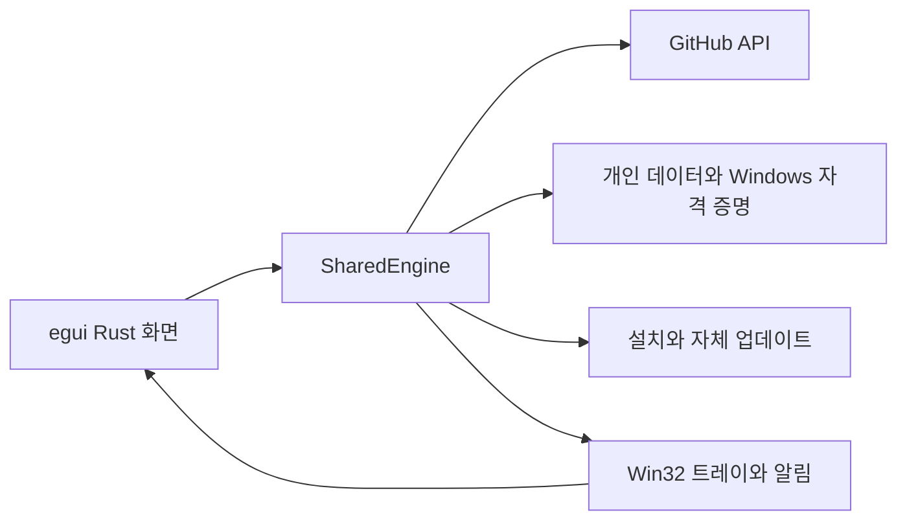

# Rust 네이티브 런처

작업 브랜치는 `codex/rust-native-rewrite`입니다. 이전 요청에서 지정한 Rust + Tauri 2 구현은 `codex/rust-tauri2-rewrite` 브랜치에 보존했습니다. 현재 실행 파일의 화면과 작업 로직은 모두 Rust로 작성하며, HTML·CSS·JavaScript·React·Tauri·WebView2를 사용하지 않습니다.

## 구성

- `native/src/gui.rs`: egui/eframe 0.37의 Rust 화면. 그리드·리스트, 검색·필터·즐겨찾기, 상세·편집·가져오기 확인, 설정을 그립니다. Windows 기본 제목 표시줄과 OpenGL 렌더러를 사용합니다.
- `native/src/engine.rs`: 화면과 독립된 작업 상태와 이벤트. Tokio에서 GitHub·다운로드·설치를 처리하며, 숨긴 창에서도 스케줄과 업데이트가 동작합니다.
- `native/src/windows.rs`: Win32 트레이 메뉴와 업데이트 알림. 별도 메시지 스레드에서 클릭을 UI 이벤트로 전달하며 Explorer 재시작 후 트레이 아이콘을 복원합니다.
- `native/src/platform.rs`: 기존 단일 인스턴스 이벤트·뮤텍스, 시작 프로그램 등록과 폴더·저장소 열기.
- `native/src/app_process.rs`: 업데이트 대상 실행 파일의 전체 경로와 보유한 Windows 프로세스 핸들로 종료 대상을 확인합니다. 일반 종료를 먼저 요청하고, 응답하지 않으면 화면의 명시적 승인 뒤 강제 종료합니다.
- `storage`, `credentials`, `github`, `artwork`, `download`, `install`, `self_update`: 검증한 Rust 데이터·인증·배포 코드를 재사용합니다.



## 데이터와 기능 호환

기본 데이터 경로 `%LOCALAPPDATA%\MoaLauncher`, 개인 카탈로그·설정·설치 상태 JSON, GitHub 자격 증명 대상 이름을 유지합니다. 이전 이행에서 사용한 `migration-backup/tauri-v1/` 백업 경로도 호환을 위해 유지합니다. 폴더명은 런타임 의존성과 관계없습니다.

그리드 기본값과 저장한 보기, 즐겨찾기, 설치 버전, 확인 간격(기본 1시간), 알림 설정을 이어받습니다. ZIP·Inno·NSIS 설치, 체크섬·취소, 트레이 모두 업데이트와 런처를 마지막에 진행하는 순서를 유지합니다. 런처 자체 업데이트는 별도 helper의 검증·백업·실패 복구·재시작을 사용합니다.

일반 앱 업데이트는 다운로드·파일 검증을 끝낸 뒤 실행 중인 앱에 종료를 요청합니다. 5초 뒤에도 남아 있으면 강제 종료 확인창을 표시하며, 취소하면 기존 설치를 유지하고 모두 업데이트의 나머지 작업도 멈춥니다. 트레이에서만 실행 중인 런처도 확인이 필요하면 창을 표시합니다.

닫기는 창을 숨기고 트레이에 남깁니다. `--background`는 처음부터 창을 숨기며, 같은 데이터 폴더에서 다시 실행하면 기존 창을 복원합니다. 자동 실행 등록과 기존 Inno AppId·설치 경로·실행 파일명도 같습니다.

## 개발과 검증

Windows x64, Rust 1.95 이상, Visual Studio C++ Build Tools와 Windows SDK가 필요합니다. Node.js와 WebView2 Runtime은 필요하지 않습니다.

```powershell
cargo run --locked --manifest-path native/Cargo.toml
cargo fmt --manifest-path native/Cargo.toml -- --check
cargo clippy --locked --manifest-path native/Cargo.toml --all-targets -- -D warnings
cargo test --locked --manifest-path native/Cargo.toml
cargo build --release --locked --manifest-path native/Cargo.toml --bin MoaLauncher
./scripts/Publish-Rust.ps1 -Version 0.3.2 -IsccPath <ISCC.exe 경로>
```

기존 런처가 실행 중이면 트레이의 종료를 먼저 선택합니다. 격리 시험에는 `MoaLauncher.exe --data-dir <별도 폴더>`를 사용합니다. 인증은 데이터 경로별로 구분되므로 별도 폴더에 자동 복사하지 않습니다.

실제 검증 결과와 범위는 [네이티브 검증 문서](native-verification.md)에 기록합니다. WPF 코드는 비교용으로 남아 있으며 새 실행 파일의 빌드에는 포함되지 않습니다.
